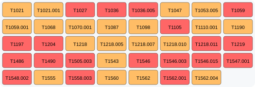

# 🛡️ Detection Engineering Dashboard

## 📊 Lefedettségi Vizualizáció
Ez az ábra automatikusan frissül a szabályok alapján:

**Jelmagyarázat:** 🔴 High/Critical | 🟠 Medium | 🟡 Low

---
### 📈 Statisztikák
- **Lefedettség:** 19.4%
- **Szabályok száma:** 34 db
- **Részletes lista:** [COVERAGE.md](./COVERAGE.md)
- **Interaktív Navigator:** [Kattints ide](https://mitre-attack.github.io/attack-navigator/#layerURL=https://raw.githubusercontent.com/horvath21tamas/detection-engineering/test/attack_navigator_layer.json)
